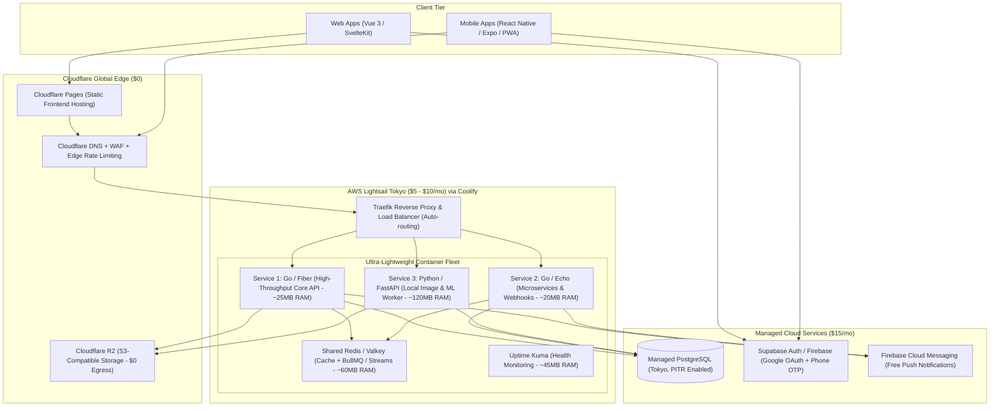

# Production Multi-Project Architecture & Technology Stack Specification
**Target Region:** Japan (Tokyo `ap-northeast-1`, <15ms latency)  
**Target Budget:** ~$15 – $25 USD / month total  
**Target Scope:** Multi-project (5–10+ web apps, lightweight microservices, mobile apps)  
**Core Design Philosophy:** *Stateless, ultra-low-RAM compute with protected, zero-risk managed state.*

---

## 1. Executive Summary & The Core Rule

When deploying multiple client-facing projects on a lean budget, the most critical architectural rule is:

> **Separate Compute from State.**  
> Web servers, workers, and API containers are disposable commodity assets. If a container crashes, a memory leak occurs, or a server burns down, it can be redeployed from Git in minutes. **Client data is irreplaceable.** Therefore, backends and caches run on cost-effective self-managed compute (Go/Python on Lightsail), while databases run on isolated, managed infrastructure with Point-in-Time Recovery (PITR).

---

## 2. Multi-Tier Target Architecture



---

## 3. Technology Stack & Component Decision Matrix

| Layer | Recommended Choice | Practical Alternatives | Why? (Decision Rationale) |
| :--- | :--- | :--- | :--- |
| **Primary Backend APIs** | **Go (`Fiber` / `Echo` / `Gin`)** | Rust (`Axum`) | **Extreme Efficiency & Low RAM.** Go APIs consume only **15MB–25MB RAM** idling and start in milliseconds. A tiny $5/mo VPS can run 5–10 Go APIs without memory pressure. |
| **Local Image & ML Tasks** | **Python (`FastAPI` + `OpenCV` / `Pillow`)** | Go (`bimg` via libvips) | **Ecosystem Maturity.** When local computer vision, offline OCR, or image manipulation models must be hosted on-server, Python offers the richest ecosystem. |
| **Frontend Framework** | **Vue 3 (Vite)** or **SvelteKit** | React / Heavy Next.js | **Performance & Bundle Size.** Sub-50KB initial bundles, instant reactivity, low client CPU overhead, and seamless mobile responsiveness. |
| **Mobile Applications** | **React Native (Expo)** or **Capacitor.js** | Native iOS/Android | **Unified Codebase & Speed.** Avoid maintaining multiple codebases. Shares up to 80% of business models, validation logic, and API clients with the web tier. |
| **Compute / Host** | **AWS Lightsail (Tokyo)** via **Coolify** | Pure AWS EC2, Hetzner, Hostinger | **Latency & Reliability.** AWS Lightsail Tokyo (`ap-northeast-1`) delivers 3–15ms latency inside Japan with EBS replicated storage and predictable flat pricing ($5–$10/mo). |
| **Database Tier** | **Managed PostgreSQL** (Lightsail Managed DB or Neon) | Self-hosted DB in Docker | **Zero-Risk Client Data.** Isolated from application crashes and disk overflows. Includes **Point-in-Time Recovery (PITR)** to roll back to any exact second. |
| **File Storage** | **Cloudflare R2** | AWS S3, Google Drive | **Bandwidth & Egress Fees.** S3-compatible, 10 GB free tier, and **$0 download/egress bandwidth fees**. Avoids Google Drive API rate-limiting. |
| **Cache & Queue** | **Redis / Valkey** (Streams / BullMQ) | Apache Kafka, RabbitMQ | **Resource Footprint.** Kafka consumes 1.5GB–2.5GB RAM idling. Redis handles retries, rate-limits, and queues in under 60MB RAM. |
| **Authentication** | **Supabase Auth** or **Firebase Auth** | Custom auth from scratch | **Standardized Flows.** Built-in Google One-Tap, Phone SMS OTP, and session management with generous free tiers (50,000 MAUs). |

---

## 4. Deep Dive: Go & Python for High-Performance, Low-Cost Execution

### A. Why Go is the Primary Backend Language
* **Minimal Footprint:** Compiles into a single static binary (~15MB) with zero runtime dependencies.
* **Instant Startup:** Cold starts take **< 15 milliseconds**, allowing rapid auto-healing and instant rolling deployments.
* **Goroutine Concurrency:** Go handles 50,000+ concurrent connections effortlessly using lightweight green threads (~2KB per goroutine) with low CPU overhead.
* **Zero Boilerplate for AI:** Modern AI models (Gemini, Claude) generate production-grade Go with virtually no compiler friction or dependency hell.

### B. When to Use Python for Local Image & ML Workloads
* When applications require **locally hosted image processing** (e.g. offline OCR, custom watermarking, background removal, or object detection) rather than external cloud APIs:
  * Deploy a dedicated Python microservice (`FastAPI` + `Pillow` / `OpenCV`).
  * Consumes ~100MB–150MB RAM—still lightweight enough to sit alongside Go APIs on a small VPS.

### C. Low-RAM Japanese PDF Generation: Typst
* To avoid running heavy headless browsers (like Chrome, which consumes 250MB+ RAM), use **Typst (`typst.app`)**:
  * An open-source, CLI-based typesetting engine written in Rust.
  * Consumes only **~15 MB RAM** and compiles complex Japanese PDFs in **under 30 milliseconds**.
  * Full native support for CJK fonts (`Noto Sans JP`, `IPAexGothic`) and Japanese line-breaking rules (*Kinsoku Shori* / 禁則処理).
  * Go calls Typst via a one-line CLI execution: `typst compile invoice.typ invoice.pdf`.

---

## 5. Multi-Application Hosting on a Single Lightsail VPS

Using **Docker + Coolify**, multiple independent Go and Python applications, microservices, and databases coexist on a single Lightsail instance without interference.

### A. Automatic Reverse Proxy & Routing (No Manual Nginx)
* **Traefik Engine:** Coolify manages Traefik automatically. When an app container starts, Traefik detects it, assigns SSL certificates (Let's Encrypt), and routes requests based on subdomain:
  * `api-main.domain.com` ➔ Container 1 (Go API)
  * `api-service2.domain.com` ➔ Container 2 (Go Microservice)
  * `worker-vision.domain.com` ➔ Container 3 (Python Image Worker)
* **Internal Load Balancing:** Scaling any container to 2+ replicas triggers automatic round-robin load balancing in Traefik.
* **Rate Limiting:** Managed at two levels:
  1. *Edge Level (Cloudflare WAF):* Blocks DDoS and brute-force traffic before reaching the server.
  2. *Container Level (Traefik middleware):* Applies per-IP rate limits directly via container labels.

### B. Memory (RAM) Budget on Lightsail (1 GB – 2 GB Plan)
Because the stack avoids heavy runtime overhead, multiple services run comfortably on low-cost tiers:

| Service / Container | Language / Tool | Allocated RAM |
| :--- | :--- | :--- |
| **Coolify Core & Traefik Reverse Proxy** | Go / Docker | ~200 MB |
| **Core API Service #1** | Go (`Fiber`) | **~25 MB** |
| **Microservice / Webhooks #2** | Go (`Echo`) | **~20 MB** |
| **Local Image & Vision Worker #3** | Python (`FastAPI` + `Pillow`) | **~120 MB** |
| **Async Cache & Queues** | Redis / Valkey | **~60 MB** |
| **Uptime Kuma (Monitoring)** | Node.js | **~45 MB** |
| **Linux OS Baseline** | Ubuntu 24.04 LTS | ~350 MB |
| **Total Memory Consumed** | — | **~820 MB** |
| **Remaining Headroom on 2 GB Plan ($10/mo)** | **For spikes & page cache** | **~1.18 GB Free** |

---

## 6. Observability, Logging & Alerting Playbook

A resilient, zero-bloat monitoring stack that operates within the free tiers:

```
┌────────────────────────────────────────────────────────────────────────┐
│                    OBSERVABILITY & ALERTING TIERS                      │
├─────────────────────┬──────────────────────┬───────────────────────────┤
│ Pillar              │ Tool                 │ Resource Cost             │
├─────────────────────┼──────────────────────┼───────────────────────────┤
│ 1. Uptime & Ping    │ Uptime Kuma (in VPS) │ ~45 MB RAM                │
│ 2. Real-time Logs   │ Coolify Dashboard    │ 0 MB (uses Docker engine) │
│ 3. Log Aggregation  │ Better Stack (Logtail)│ 0 MB (1GB/mo free cloud)  │
│ 4. Error Tracking   │ Sentry (Free Tier)   │ 0 MB (5k errors/mo free)  │
│ 5. Notifications    │ Telegram or Discord  │ 100% Free instant alerts  │
└─────────────────────┴──────────────────────┴───────────────────────────┘
```

1. **Uptime & Endpoint Monitoring:** Deploy **Uptime Kuma** in Coolify. Pings health endpoints (`/healthz`) and checks SSL certificate expiration every 60 seconds.
2. **Server & Container Alerts:** Coolify natively monitors host resources. If **RAM > 85%**, **CPU > 90%**, or a container exits abnormally, it dispatches webhook alerts to **Telegram, Discord, or Slack**.
3. **Application Error Tracking:** Integrate the **Sentry SDK** into Go/Python services to capture unhandled exceptions, stack traces, and request context.
4. **Log Streaming:** Pipe application `stdout`/`stderr` to **Better Stack (Logtail)** or **Grafana Cloud Free Tier** for searchable historical logs without consuming local disk space.

---

## 7. Bill of Materials (Monthly Cost Breakdown)

| Service | Role | Provider | Cost |
| :--- | :--- | :--- | :--- |
| **Web Frontends** | Static Sites, PWA, Edge CDN | Cloudflare Pages | **$0.00** |
| **File Storage (S3)** | Assets, User Uploads, Documents | Cloudflare R2 (10 GB free, $0 egress) | **$0.00** |
| **Authentication** | Google OAuth + Phone SMS OTP | Supabase Auth / Firebase (50k MAU) | **$0.00** |
| **Push Notifications**| iOS & Android Alerts | Firebase Cloud Messaging (FCM) | **$0.00** |
| **DNS, SSL & DDoS** | Edge Caching & WAF Protection | Cloudflare Free Plan | **$0.00** |
| **Compute Server** | Multi-App Containers, Caches, Queues | AWS Lightsail Tokyo (1GB–2GB RAM) | **$5.00 – $10.00** |
| **Managed Database** | PostgreSQL with PITR Backups | AWS Lightsail Managed DB (or Neon) | **$15.00** |
| **Total Monthly Run Rate** | **Complete Multi-Project Fleet** | — | **~$20.00 – $25.00 / mo** |

---

## 8. Deployment Runbook

1. **Edge & Domain Setup:** Point domain nameservers to Cloudflare. Connect frontend Git repositories to Cloudflare Pages.
2. **Provision Host:** Launch an Ubuntu 24.04 instance on AWS Lightsail Tokyo (`ap-northeast-1`).
3. **Install Coolify Orchestrator:** Run the official installer:
   ```bash
   curl -fsSL https://cdn.coollabs.io/coolify/install.sh | bash
   ```
4. **Deploy Application Fleet:** In the Coolify dashboard (`http://server-ip:8000`), link Git repositories for each Go/Python service. Configure environment variables (`DATABASE_URL`, `REDIS_URL`, `R2_CREDENTIALS`).
5. **Connect Managed Database:** Configure application containers to connect to the Managed PostgreSQL instance over private network / SSL.
6. **Configure Storage:** Create Cloudflare R2 buckets and provision S3 API access keys.
7. **Enable Monitoring:** Deploy Uptime Kuma and configure alert webhooks to Telegram/Discord.

---

## 9. Appendix: Comparative Analysis — Go/Rust vs. JVM/Kotlin

For teams evaluating whether to build in **Go/Rust** versus **JVM/Kotlin (Spring Boot)**, the operational, cost, and performance differences are substantial:

```
┌────────────────────────────────────────────────────────────────────────┐
│                   GO / RUST VS. JVM / KOTLIN COMPARISON                │
├─────────────────────┬──────────────────────────┬───────────────────────┤
│ Metric / Dimension  │ Go / Rust                │ JVM / Kotlin (Spring) │
├─────────────────────┼──────────────────────────┼───────────────────────┤
│ Baseline Idle RAM   │ ~15 MB - 25 MB           │ ~350 MB - 500 MB      │
│ Cold Start Time     │ < 15 milliseconds        │ 4 - 8 seconds         │
│ Memory Multiplication│ 5 apps = ~100 MB RAM     │ 5 apps = ~2,000 MB RAM│
│ Smallest Viable VPS │ 512 MB ($3.50/mo)        │ 2 GB ($10/mo)         │
│ Docker Image Size   │ ~15 MB (Scratch binary)  │ ~250 MB - 400 MB (JRE)│
│ GC Latency Spikes   │ Ultra-low (<1ms pause)   │ High under tight RAM  │
└─────────────────────┴──────────────────────────┴───────────────────────┘
```

### Why Sticking to Go/Rust is Superior for Cost & Performance:

1. **Eliminating the "Memory Tax" (The Multiplication Effect):**
   * On the JVM, every running application requires its own dedicated Java Virtual Machine, classloader, JIT compiler structures, and thread stacks. Running **5 small client applications** on Kotlin/Spring Boot demands **~2 GB of RAM just sitting idle**.
   * In **Go**, 5 independent microservices consume **~100 MB total**. You can run an entire company portfolio of microservices on a single **$5/mo VPS** without exhausting server memory.

2. **Predictable Performance Under Low-Cost Hardware:**
   * When a JVM app is constrained to a small memory limit (e.g. 512MB), garbage collection algorithms (G1GC/ParallelGC) fight continuously to reclaim memory, causing CPU thrashing and sudden 500ms+ response spikes.
   * Go’s runtime is designed for low-latency, concurrent execution with sub-millisecond GC pauses, maintaining consistent sub-10ms response times even under load on a 1 vCPU machine.

3. **Instant Auto-Healing & Scaling:**
   * If an unhandled panic crashes a Go container, Docker restarts it in **under 20 milliseconds**. Users never notice the downtime.
   * A JVM container takes **5 to 10 seconds** to boot Spring beans, perform classpath scanning, and warm up JIT caches, resulting in visible 502 Bad Gateway errors during restarts.

4. **The Exception Where JVM Has an Advantage:**
   * The primary technical justification for JVM/Kotlin in modern web development is **complex document engines** (such as `iText 7` for enterprise multi-page PDF generation with complex layout calculations). 
   * However, by adopting lightweight modern alternatives like **Typst** (sub-30ms compile time, ~15MB RAM, native Japanese typography), Go systems achieve equal typographic fidelity without paying the massive JVM memory penalty.
