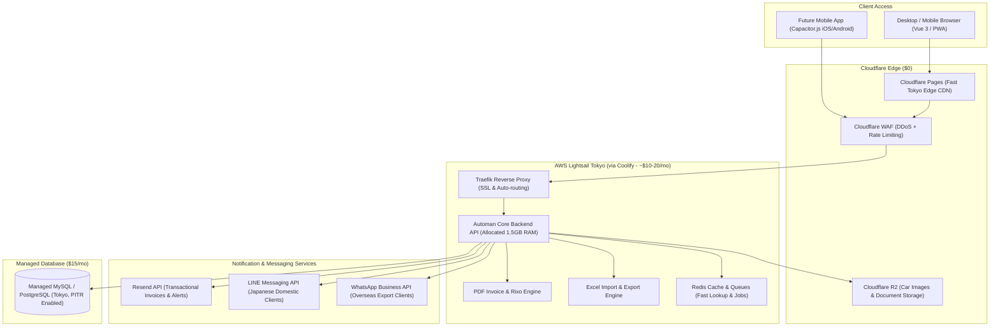

# Automan 2.0: Target Architecture & Technology Roadmap Specification

**System:** Automan Car Purchase & Shipping Management System  
**Current Tech:** Kotlin/JS Compose (Frontend) + Kotlin Spring Boot 3 (Backend API) + MySQL + Cloudflare R2  
**Target Hosting:** Cloudflare Pages (Frontend) + AWS Lightsail Tokyo (Backend) + Managed DB + Cloudflare R2  
**Target Market:** Japan (Domestic auctions/dealers) & Export Destinations (International clients)

---

## 1. System Target Architecture



---

## 2. Infrastructure & Feature Modernization Plan

### A. Frontend: Vercel ➔ Cloudflare Pages & Transition to Vue 3
> **Goal: Eliminate Pacific Ocean routing latency and improve mobile table responsiveness.**

| Factor | Current: Kotlin/JS Compose on Vercel | Target: Vue 3 (Vite) on Cloudflare Pages |
| :--- | :--- | :--- |
| **Hosting Platform** | Vercel (Edge routing hops to US) | **Cloudflare Pages ($0, Native Tokyo Edge CDN)** |
| **Bundle Size** | Heavy (~2MB–3MB uncompressed JS) | **Ultra-light (<100KB gzipped, instant load)** |
| **UI Ecosystem** | Handcrafted UI; few web table libraries | **Rich UI libraries (PrimeVue, Shadcn-Vue, Tailwind)** |
| **Mobile Responsiveness** | Complex to customize for mobile | **Mobile-first components out-of-the-box** |
| **Capacitor Support** | Experimental bindings | **First-class official Capacitor CLI integration** |

* **Migration Strategy:**
  * **Immediate Step:** Deploy the static frontend output to **Cloudflare Pages** instead of Vercel. This serves assets directly from Cloudflare's Tokyo edge cache with zero bandwidth costs.
  * **Mid-Term Step:** Transition frontend views to **Vue 3 (Vite) + Tailwind CSS**. Automan is a data-heavy application (tables, filters, FOB calculators, bulk checkboxes). Vue 3 with **TanStack Table** or **PrimeVue** allows building fast, responsive data grids with significantly less code.

---

### B. Image & Media Storage: Cloudflare R2 (Keep As Is)
> **Goal: Maintain zero bandwidth egress costs for vehicle photography.**

* Automan is already configured for R2 (`automan.media.r2` configuration and `V61__purchase_media.sql`).
* **Why R2 Wins:**
  * **$0 Egress Fees:** Car software involves clients viewing 20–30 high-resolution photos per vehicle. AWS S3 charges $0.09/GB for downloads, which inflates bills. R2 bandwidth is completely free.
  * **Direct Uploads via Pre-signed URLs:** The browser uploads photos directly to R2; zero bandwidth load on your backend server.

---

### C. Image Processing Pipeline & Document Vision OCR
> **Goal: Automate vehicle photo thumbnails/watermarks and Japanese inspection sheet extraction.**

```
┌─────────────────────────────────────────────────────────────────────────────┐
│                       AUTOMAN MEDIA & OCR PIPELINE                          │
└─────────────────────────────────────────────────────────────────────────────┘

 [User Uploads Vehicle Photos or Japanese Shaken / Auction Sheet]
                                │
                                ▼
         Browser Uploads Directly to Cloudflare R2 (Pre-Signed URL)
                                │
                                ▼
              Backend Event / API Processing Trigger
                                │
        ┌───────────────────────┴───────────────────────┐
        ▼                                               ▼
 [Workload 1: Media Optimization]            [Workload 2: Document OCR]
 • Thumbnailator + TwelveMonkeys             • Gemini 2.0 Flash Vision API
 • Generate 400x300 WebP Table Thumbnail     • Parse Japanese Shaken (車検証)
 • Generate 1600x1200 Watermarked Preview    • Extract Chassis, Year, Model Code
 • 75% smaller file size vs raw camera HEIC  • Auto-fills Purchase & Booking Form
        │                                               │
        └───────────────────────┬───────────────────────┘
                                ▼
              Save Metadata to MySQL (`purchase_media`)
```

#### 1. Vehicle Photo Resizing & Watermarking:
* **Automatic Dual Generation:** When yard staff upload a 10MB phone photo, the pipeline automatically produces:
  1. *Table Thumbnail (400x300 WebP, ~25KB):* For instant loading in shipping lists and purchase history tables.
  2. *Export Preview (1600x1200 WebP, ~180KB):* Overlaid with a transparent company logo or watermark to protect photos from unauthorized reuse by other brokers.

#### 2. Document Extraction & OCR (Japanese 車検証 & Auction Sheets):
* **Avoid Heavy Local OCR:** Running local OCR models (e.g. Tesseract) on the server consumes excessive memory and struggles with Japanese kanji and low-contrast vehicle stamps.
* **Multimodal Cloud Vision:**
  * Send the document image directly to **Gemini 2.0 Flash Vision API** from the backend.
  * Costs **less than $0.001 per scan** with sub-second response times.
  * Extracts structured JSON:
    ```json
    {
      "chassis_number": "B43W-0012345",
      "first_registration_year": "2021",
      "model_code": "5BA-B43W",
      "engine_type": "BR06",
      "inspection_expiry": "2026-05-15"
    }
    ```
  * Automatically pre-fills the purchase and booking forms to eliminate manual typing errors.

---

## 3. Mobile Strategy & Client Reminder Notifications

### A. Mobile Browser First (Why No Native App Needed Now)
* **iOS Dominance in Japan:** Over **65% to 70%** of smartphones in Japan are iPhones.
* **App Store Friction:** Publishing a native iOS app requires a $99/year Apple Developer account, strict review guidelines, and days of review delays for every update.
* **Recommendation:** **A responsive mobile web app is sufficient.** Touch-friendly tables and sticky action buttons provide a fast mobile experience without App Store overhead.

---

### B. Delivering Client Reminders Without an App

#### Why Open Browser Tabs Are Unreliable:
* Mobile operating systems (iOS and Android) aggressively freeze or kill background browser tabs within 3 to 5 minutes to conserve battery and memory. Background JavaScript and WebSockets halt.

#### The Recommended Notification Strategy: Direct Messaging APIs

```
┌────────────────────────────────────────────────────────┐
│             NOTIFICATION DISPATCH STRATEGY             │
└────────────────────────────────────────────────────────┘

 [Payment Due / Vessel Arrival / Shipping Status Event]
                           │
                           ▼
                 Automan Backend API
                           │
              ┌────────────┴────────────┐
              ▼                         ▼
   [Domestic Japan Clients]    [Overseas Export Clients]
              │                         │
              ▼                         ▼
     LINE Messaging API          WhatsApp Business API
     (95%+ open rate)            (or Resend Email)
```

1. **For Japanese Domestic Clients (Dealers, Auctions, Buyers):**
   * **Use the LINE Messaging API (LINE Official Account):**
   * LINE has over **95% penetration across Japan** (WhatsApp is rarely used domestically).
   * Automan dispatches automated push updates directly to a client's LINE chat: *"Payment pending for Chassis #B43W-t6yg"* or *"Car arrival confirmed"*.
   * Free tier includes 200 messages/month; paid tiers are inexpensive.
2. **For International / Export Clients (Africa, Middle East, South Asia):**
   * **Use the WhatsApp Business API** (via Twilio or Meta Cloud API).
   * Worldwide vehicle importers operate predominantly on WhatsApp. Automan can automatically dispatch invoice PDFs and booking confirmations directly to their WhatsApp threads.
3. **Email (Already Integrated):**
   * Continue utilizing the existing **Resend API** setup for formal invoices and account verification.

---

### C. Future Native App: The Capacitor.js Fast-Track

When auction yard staff or clients require native mobile features (such as using the **phone camera to scan chassis numbers** or upload photos directly from the yard):

**Wrap the responsive web frontend with Capacitor.js (by Ionic):**
* Packages the web code into native **`.ipa` (iOS)** and **`.apk` (Android)** binaries.
* Exposes native mobile capabilities:
  * **Native Push Notifications (APNs / FCM)**
  * **Native Camera Access** (directly streaming photos to Cloudflare R2)
  * **Biometric Authentication** (FaceID / TouchID)
* **Zero code duplication:** Maintain one codebase across desktop, mobile web, iOS, and Android.

---

## 4. Summary of Immediate Action Items for Automan 2.0

1. **Host Backend on AWS Lightsail Tokyo:** Deploy the backend container via Coolify with a 1.5GB RAM allocation to eliminate Railway memory limits and ensure sub-15ms response times.
2. **Move Frontend to Cloudflare Pages:** Build the frontend static bundle and deploy to Cloudflare Pages for sub-10ms delivery across Japan with zero bandwidth cost.
3. **Retain Cloudflare R2:** Continue using the existing R2 setup for vehicle photo storage.
4. **Notification Layer:** Integrate **LINE Messaging API** (for Japanese domestic clients) and **WhatsApp API** (for overseas export clients) alongside existing **Resend** emails.
5. **Future App Path:** When native app features (Camera, FaceID, Push) are required, wrap the responsive frontend using **Capacitor.js**.
